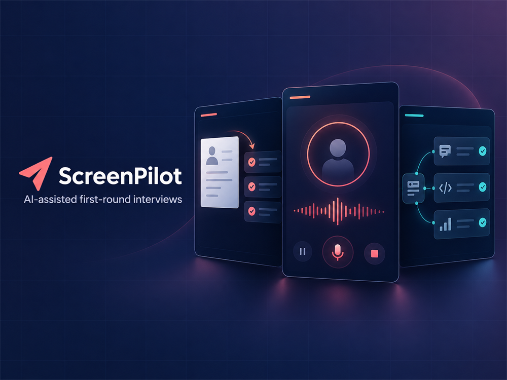

<h1 align="center">ScreenPilot</h1>

<p align="center">
  <strong>Automate the first interview. Keep the hiring decision human.</strong>
</p>

<p align="center">
  <a href="https://tryscreenpilot.com"><strong>Try the live demo</strong></a>
  ·
  <a href="docs/SCREENPILOT_DEMO_SOURCE_OF_TRUTH.md">Product architecture</a>
  ·
  <a href="docs/SCREENPILOT_DESIGN_SYSTEM.html">Design system</a>
</p>

<p align="center">
  
</p>

ScreenPilot is a privacy-minded AI screening experience that conducts a disclosed first-round voice interview, adapts to what the candidate says, and turns the conversation into an evidence-linked review for a recruiter.

It is intentionally a decision-support tool—not a hiring engine. ScreenPilot never scores, ranks, rejects, or recommends candidates.

## Why ScreenPilot

| Grounded conversations                                                                                          | Reviewable evidence                                                                                                  | Human control                                                                                                 |
| --------------------------------------------------------------------------------------------------------------- | -------------------------------------------------------------------------------------------------------------------- | ------------------------------------------------------------------------------------------------------------- |
| Start from an optional CV or a role-neutral conversation, then adapt follow-ups to the candidate's own answers. | Connect every review insight to the CV or transcript evidence behind it instead of producing an unexplained verdict. | Keep recruiters responsible for judgment while candidates can inspect the experience and clear their session. |

## From introduction to review

1. **Choose a starting point** — upload a text-based CV or begin without one.
2. **Prepare safely** — disclose the AI interviewer, confirm consent, and check the microphone.
3. **Have the conversation** — Pilot runs a bounded general-HR interview with live captions and adaptive follow-ups.
4. **Review the evidence** — ScreenPilot organizes candidate-sourced facts into a structured, evidence-linked handoff.

Any bounded role label supplied by a candidate is treated as an untrusted, synthetic demo vacancy for that browser session. It changes the label—not the standard of assessment—and never becomes a technical or hiring-suitability test.

## Built for trust

- **Stateless by design:** candidate content remains in the active browser/request lifecycle; there is no candidate database, durable transcript store, background queue, or hidden server session.
- **Evidence before inference:** CV suggestions remain provisional, candidate speech is authoritative, and unsupported employer facts are never invented.
- **Private provider boundary:** OpenAI and ElevenLabs credentials stay server-side; the browser uses relative `/v1` endpoints and short-lived access.
- **Safe development defaults:** local development and automated checks use deterministic fake providers and cannot spend provider credits by default.

## Under the hood

| Layer            | Technology                                                   |
| ---------------- | ------------------------------------------------------------ |
| Experience       | Next.js 16, React 19, TypeScript                             |
| API              | Node.js 24, Express 5                                        |
| Contracts        | Shared Zod schemas                                           |
| AI and voice     | OpenAI Responses API, ElevenLabs Agents/WebRTC               |
| Abuse protection | Cloudflare Turnstile, bounded admission controls             |
| Delivery         | Docker, Artifact Registry, Google Cloud Run                  |
| Quality          | ESLint, Prettier, strict TypeScript, Vitest, Testing Library |

```text
Browser
  └─ Next.js experience + same-origin /v1 proxy
       ├─ shared, browser-safe Zod contracts
       └─ Express API
            ├─ OpenAI adapter
            └─ ElevenLabs adapter
```

The dependency direction stays deliberately narrow:

```text
frontend -> contracts <- backend
```

## Explore the repository

| Area                 | What lives there                                                                                       | Guide                                                     |
| -------------------- | ------------------------------------------------------------------------------------------------------ | --------------------------------------------------------- |
| `apps/frontend`      | Responsive candidate journey, browser session state, PDF extraction, microphone and voice UI           | [Frontend guide](apps/frontend/README.md)                 |
| `apps/backend`       | Stateless HTTP API, admission controls, provider adapters, interview preparation and review generation | [Backend guide](apps/backend/README.md)                   |
| `packages/contracts` | Browser-safe schemas shared across the API boundary                                                    | [Source tree](packages/contracts/src)                     |
| `docs`               | Product decisions, design language, delivery notes, and implementation tickets                         | [Documentation](docs/SCREENPILOT_DEMO_SOURCE_OF_TRUTH.md) |

## Run it locally

Requirements: Git, Node.js **24.20.0** (see [`.node-version`](.node-version)), and Corepack with pnpm **11.24.0**.

```bash
corepack enable
corepack pnpm install --frozen-lockfile
```

No provider credentials are required for the default fake mode. Continue with the [backend setup](apps/backend/README.md#run-locally), then the [frontend setup](apps/frontend/README.md#run-locally). Contributors using an automated coding agent should follow the process and safety rules in [`AGENTS.md`](AGENTS.md).

Run the unpaid workspace quality gate with explicit safe provider settings:

```powershell
$env:PROVIDER_MODE = "fake"
$env:PAID_DEMO_ENABLED = "false"
corepack pnpm verify:quick
```

## Project documentation

- [ScreenPilot demo source of truth](docs/SCREENPILOT_DEMO_SOURCE_OF_TRUTH.md)
- [Signal Canvas design-system reference](docs/SCREENPILOT_DESIGN_SYSTEM.html)
- [Implementation ticket index](docs/tickets/README.md)
- [Repository agent instructions](AGENTS.md)

ScreenPilot is a portfolio demonstration, not a production applicant-tracking system. Committed examples use synthetic content only; real CVs, transcripts, audio, generated candidate summaries, credentials, and service-account files must never enter version control.

<p align="center">
  Built and maintained by <a href="https://github.com/minatamer">Mina Tamer</a>.
</p>
